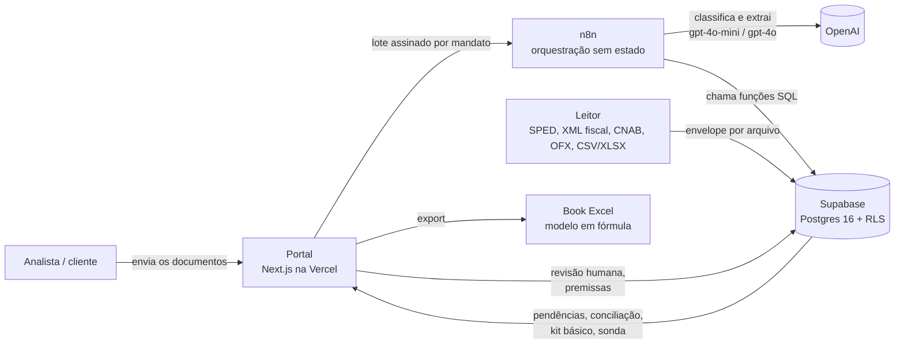

# Oria Digital — tratamento de dados financeiros

[](https://github.com/rodrigovaroto-wq/Oria-Digital/actions/workflows/suites.yml)

Sistema interno da **Oria Partners** que recebe os documentos financeiros de um mandato de M&A ou
reestruturação (balanços, DREs, balancetes, razões, planilhas de dívida, arquivos fiscais),
extrai as demonstrações com IA, grava cada número no Postgres com a sua origem e entrega ao
analista um book em Excel com o modelo de FP&A **vivo em fórmula**.

O projeto parte de um princípio: **nenhum número sem origem, nenhuma ausência disfarçada de zero.**
Quando o sistema não consegue ler, conferir ou decidir alguma coisa, ele diz isso, com o motivo
e o efeito, em vez de devolver um valor plausível.

---

## Como as peças se conectam



| Camada | Papel | Onde está |
|---|---|---|
| **Banco** (Supabase / Postgres) | É a fonte da verdade e o motor. Guarda o estado, faz toda a aritmética e a conciliação, recusa dado inconsistente, aplica RLS por mandato e se autoconfere pela sonda `fn_instalacao_conferir()`. | [`Supabase/`](Supabase/) |
| **Orquestração** (n8n) | Recebe o lote, classifica cada arquivo, chama a IA, mede custo e cobertura e grava pelo banco. Não guarda estado. Os workflows são **gerados por código**; o JSON importado no n8n é derivado. | [`N8N/`](N8N/) |
| **Portal** (Next.js) | Tela do mandato, fila de revisão, pendências, modelagem de premissas, export do book e apresentação de crédito. | [`portal/`](portal/) |
| **Leitor** | Lê arquivos oficiais e tabulares de forma determinística, sem IA. Hoje roda como linha de comando; o n8n ainda não o chama. | [`Leitor/`](Leitor/) |

O fluxo completo, em linguagem simples, está em
[`Como o sistema funciona`](Arquitetura%20do%20Sistema/3%20Estado%20e%20Execução/COMO_O_SISTEMA_FUNCIONA.md).

---

## Mapa do repositório

```
.
├── Supabase/                 Banco: 189 migrations, schema derivado, 124 testes SQL, sondas
│   ├── migrations/           NNNN_<o defeito que ela corrige>.sql — aplicadas em ordem
│   ├── test/                 run.sh monta o banco do zero e roda todas as suítes
│   ├── conferir/             conferidor das chamadas n8n → SQL (gerado)
│   ├── seed/  rollback/      dados de catálogo e reversões declaradas
│   └── schema.sql            DERIVADO do run.sh — nunca editar à mão
├── N8N/                      Orquestração
│   ├── build-workflow*.mjs   geradores dos 4 workflows
│   ├── lib/                  a lógica dos nós Code, testável fora do n8n
│   ├── test/                 suíte node:test
│   └── workflow.*.json       DERIVADOS — o que se importa no n8n
├── portal/                   Next.js 16 + React 19 + TypeScript + Tailwind
│   ├── src/app/              rotas (mandatos, revisão, modelagem, export, administração)
│   ├── src/lib/              acesso ao banco, export (exceljs), apresentação
│   └── scripts/verificar-*   invariantes do arquivo entregue ao cliente
├── Leitor/                   leitura determinística de arquivos oficiais e tabulares
├── Verificação/              testes de ponta a ponta e vistorias contra o portal no ar
├── Dados de Teste/           books sintéticos (geradores Python) e capturas de rodadas reais
├── Arquitetura do Sistema/   visão, especificação, plano, auditorias, referência e marca
├── Apresentações/            material de negócio (Business Plan); não faz parte do sistema
├── .github/workflows/        CI e operações (ver abaixo)
├── .claude/                  memória, agentes e portões do desenvolvimento assistido por IA
├── ESTADO.md                 onde o projeto está agora (leia só o topo)
├── HANDOFF.md                histórico completo das sessões (arquivo morto, consulta pontual)
└── CLAUDE.md                 instruções carregadas em toda sessão do Claude Code
```

Cada pasta de código tem o próprio README com o detalhe: [`Supabase/README.md`](Supabase/README.md),
[`N8N/README.md`](N8N/README.md), [`portal/README.md`](portal/README.md),
[`Leitor/README.md`](Leitor/README.md), [`Verificação/README.md`](Verificação/README.md) e
[`Dados de Teste/README.md`](Dados%20de%20Teste/README.md).

---

## Stack

| | |
|---|---|
| Banco | Supabase (Postgres 16, Auth, Storage, RLS); lógica em PL/pgSQL |
| Orquestração | n8n (Form Trigger, nós Code em JavaScript gerados por `N8N/build-workflow*.mjs`) |
| IA | OpenAI: classificação em `gpt-4o-mini`, extração em `gpt-4o`, com orçamento por lote antes de gastar |
| Portal | Next.js 16 (App Router), React 19, TypeScript, Tailwind 4, `@supabase/ssr`, `exceljs`; deploy na Vercel |
| Testes | `node:test`, `psql` + PL/pgSQL, `tsx`, Playwright (vistorias), Python 3 (geradores dos books) |
| Qualidade | GitHub Actions + SonarCloud |

---

## Rodar localmente

Requisitos: Node 22, Postgres 16, Python 3.

```bash
cd portal && npm ci --ignore-scripts && cd ..
```

```bash
node --test 'N8N/test/*.test.mjs' 'Leitor/test/*.test.mjs' 'Supabase/test/*.test.mjs'
```

```bash
sudo -u postgres env PGHOST=/tmp PGPORT=5432 PGUSER=postgres Supabase/test/run.sh
```

O `run.sh` cria o banco `tdf_test`, aplica **todas** as migrations do zero, roda as suítes SQL e
regera `Supabase/schema.sql`. A lista completa (geradores, export, ponta a ponta, medidores), na
mesma ordem do CI, está em [`.claude/COMANDOS-CANONICOS.md`](.claude/COMANDOS-CANONICOS.md). Um
portão do CI confere que esse arquivo e o CI não divergem.

Para o portal: `cd portal && npm run dev`, com `NEXT_PUBLIC_SUPABASE_URL` e
`NEXT_PUBLIC_SUPABASE_ANON_KEY` no ambiente. O envio de documentos ainda precisa das variáveis
`N8N_INTAKE_*` (endereço do formulário do n8n e segredo do token); ver [`portal/README.md`](portal/README.md).

---

## CI e operação

| Workflow | Quando roda | O que faz |
|---|---|---|
| [`suites.yml`](.github/workflows/suites.yml) | todo push e PR | 5 jobs em paralelo: `n8n-e-derivados` (suíte n8n + regeração dos derivados com `git diff --exit-code`), `portal` (tsc, eslint, invariantes do export, build), `banco` (migrations do zero + testes SQL), `e2e` (extração → banco → export) e `variacoes` (documentos "sujos"). O agregador `suites` só fica verde se os cinco ficarem. |
| [`sonda-producao.yml`](.github/workflows/sonda-producao.yml) | todo dia às 06:10 (Brasília) e manual | roda a sonda contra o banco de **produção** e acusa o que o repositório tem e produção não |
| [`republicar.yml`](.github/workflows/republicar.yml) | manual | publica no n8n o workflow gerado a partir do repositório |
| [`perimetro-inventario.yml`](.github/workflows/perimetro-inventario.yml) | manual | inventário de entidades e perímetro dos mandatos em produção |

---

## Convenções

- **Migration conta o defeito no nome.** `0277_o_aging_que_apagava_a_divergencia_de_um_ano...sql`.
  O teste dela tem o mesmo nome em `Supabase/test/`. Cada migration registra os seus requisitos
  na sonda, e `fn_instalacao_conferir()` responde, contra qualquer banco, o que falta instalar.
  **Nenhum arquivo do repositório é autoridade sobre o banco: a sonda é.**
- **Arquivo derivado nunca se edita à mão.** `Supabase/schema.sql`, `N8N/workflow.*.json`,
  `Supabase/conferir/conferir_chamadas.sql` e `.claude/conhecimento/grafo.jsonl` são regerados
  pelos seus geradores, e o CI reprova quando o commitado diverge do gerado.
- **Invariante novo é medido não vazio.** Desliga-se a correção, confirma-se que a suíte
  reprova, religa-se. O número de asserts que reprovaram vai no commit.
- **Ausência nunca vira zero.** Célula em branco com nota do motivo e do efeito.
- **Uma fatia por commit**, com a mensagem contando o defeito, a causa e a medição.
- Código, comentários e documentação estão em **português**.

As sete regras completas, e o porquê de cada uma, estão no [`CLAUDE.md`](CLAUDE.md).

---

## Documentação

| Pasta | Conteúdo |
|---|---|
| [`1 Visão e Doutrina`](Arquitetura%20do%20Sistema/1%20Visão%20e%20Doutrina/) | escopo, doutrina de autonomia (N0 → N3), arquitetura funcional e ADRs |
| [`2 Especificação`](Arquitetura%20do%20Sistema/2%20Especificação/) | reconciliação, classificação contábil, revisão humana, status e pendências, LGPD, fontes oficiais |
| [`3 Estado e Execução`](Arquitetura%20do%20Sistema/3%20Estado%20e%20Execução/) | **plano em vigor** ([`PLANO_MVP_2026-11.md`](Arquitetura%20do%20Sistema/3%20Estado%20e%20Execução/PLANO_MVP_2026-11.md)), roadmap e desenhos técnicos |
| [`4 Análises e Auditorias`](Arquitetura%20do%20Sistema/4%20Análises%20e%20Auditorias/) | riscos, custo de IA, auditorias e vistorias medidas |
| [`5 Prompts`](Arquitetura%20do%20Sistema/5%20Prompts/) | roteiros de trabalho para o desenvolvimento assistido por IA |
| [`6 Referência`](Arquitetura%20do%20Sistema/6%20Referência/) | modelo-base do Excel, critérios de aceite, conformidade, restauração |
| [`7 Marca`](Arquitetura%20do%20Sistema/7%20Marca/) | identidade visual, produto e redesenho do portal |

O índice comentado está em [`Arquitetura do Sistema/README.md`](Arquitetura%20do%20Sistema/README.md).

---

## Estado atual

O topo do [`ESTADO.md`](ESTADO.md) diz qual é a migration mais nova, o que está aplicado em
produção e o que vem a seguir. O plano até o primeiro mandato real está em
[`PLANO_MVP_2026-11.md`](Arquitetura%20do%20Sistema/3%20Estado%20e%20Execução/PLANO_MVP_2026-11.md).
